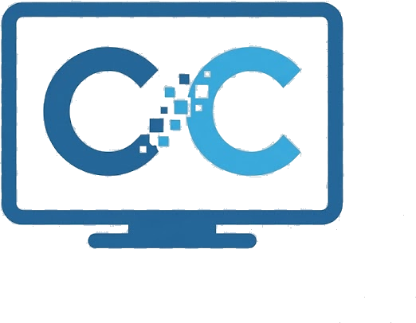
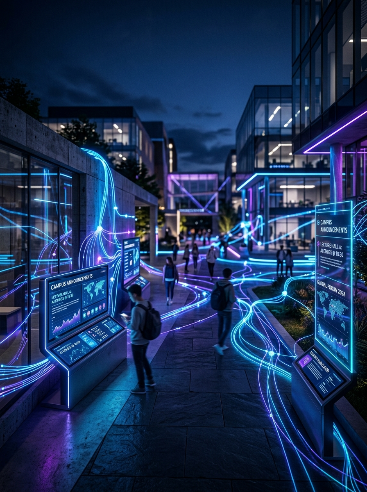
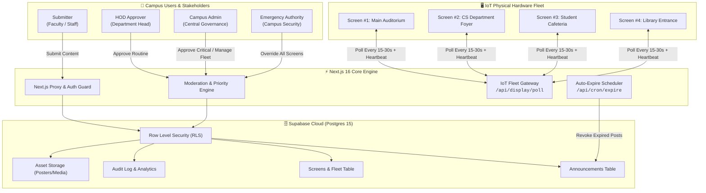

<div align="center">


<br />


# 📡 CampusCast — Governed Campus Display Network & IoT Smart Screen

**An enterprise-grade, multi-role digital signage governance & automated IoT display network.**

[](https://campuscast-smart-screen.netlify.app)
[](https://nextjs.org/)
[](https://supabase.com/)
[](https://tailwindcss.com/)
[](https://www.typescriptlang.org/)

<br />

🌐 **Live Production Link:** [https://campuscast-smart-screen.netlify.app](https://campuscast-smart-screen.netlify.app)  
📦 **Repository:** [https://github.com/Aayush-207/IOT-smart-screen](https://github.com/Aayush-207/IOT-smart-screen)

<br />



</div>

---

## 🏛️ System Architecture



---

## 🛡️ Priority & Approval Matrix

| Priority Level | Visual Badge | Approval Workflow | Target Scope | Auto-Expiry |
| :--- | :---: | :--- | :--- | :---: |
| **Routine** | 🟢 Routine | **HOD** of owning department | Department screens | 7 Days |
| **Time-Sensitive**| 🟡 Urgent | **HOD** of owning department | Specific zones / event dates | Custom Date |
| **Critical** | 🟠 Critical | **Campus Admin** (`/dashboard/admin`) | Campus-wide broadcast | 48 Hours |
| **Emergency** | 🔴 Emergency | **Zero-Approval** (Pre-authorized override) | 100% of all online displays | 4 Hours / Manual |

---

## 👥 Role-Based Access Control (RBAC)

| Role | Primary Dashboard | Key Capabilities |
| :--- | :--- | :--- |
| **`submitter`** | `/dashboard/submitter` | Draft rich announcements, select target physical zones, upload creatives, track live delivery status. |
| **`hod`** | `/dashboard/hod` | Review routine and time-sensitive departmental announcements; approve or reject with comments. |
| **`admin`** | `/dashboard/admin` | Campus-wide governance, approve critical announcements, real-time fleet health monitor, user access manager, audit logs. |
| **`emergency`** | `/dashboard/admin/emergency` | Send instantaneous campus-wide emergency banners overriding all active schedules. |

---

## 📟 IoT Hardware & Display Polling

Every edge device (Raspberry Pi, Android display, ESP32 kiosk) securely connects to CampusCast via token authentication:

```http
GET /api/display/poll?screen_id=SCREEN_UUID&token=DEVICE_SECRET
```

### Response Payload Contract

```json
{
  "status": "active",
  "screen_name": "Auditorium Main Screen",
  "refresh_interval_sec": 30,
  "active_broadcast": {
    "id": "e42718e2-...",
    "priority": "critical",
    "headline": "Annual Convocation 2026",
    "content": "All students are requested to assemble by 09:30 AM in formal attire.",
    "media_url": "https://...supabase.co/storage/v1/object/public/campuscast-media/...",
    "expires_at": "2026-11-05T18:00:00Z"
  },
  "emergency_active": false
}
```

*Displays feature **Offline Resilience**: in case of Wi-Fi degradation, the edge screen continues showing the last cached broadcast.*

---

## 🚀 Quickstart & Setup

### 1. Clone & Install Dependencies
```bash
git clone https://github.com/Aayush-207/IOT-smart-screen.git
cd IOT-smart-screen
npm install
```

### 2. Configure Environment Variables
Create a `.env.local` file with your Supabase credentials:
```env
NEXT_PUBLIC_SUPABASE_URL=https://your-project.supabase.co
NEXT_PUBLIC_SUPABASE_ANON_KEY=your-anon-key
SUPABASE_SERVICE_ROLE_KEY=your-service-role-key
CRON_SECRET=your-secure-cron-secret
```

### 3. Run Locally
```bash
npm run dev
```
Open [http://localhost:3000](http://localhost:3000) to view the application.

---

<div align="center">

**Built with ❤️ for MIT Art, Design & Technology University**  
*Empowering connected, secure, and governed campus communications.*

</div>
