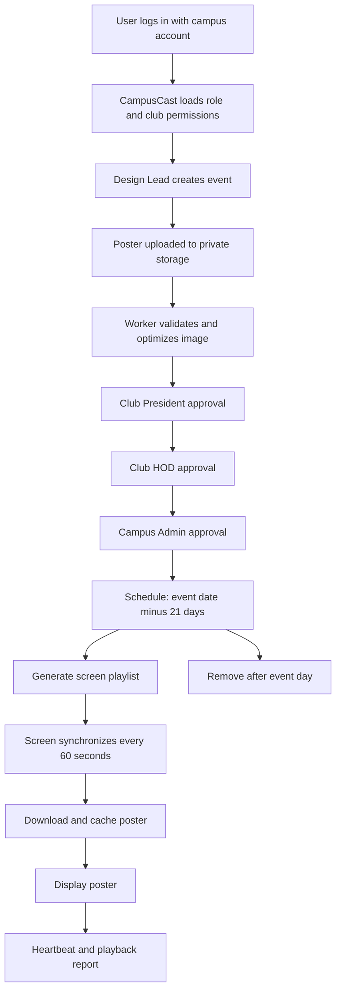
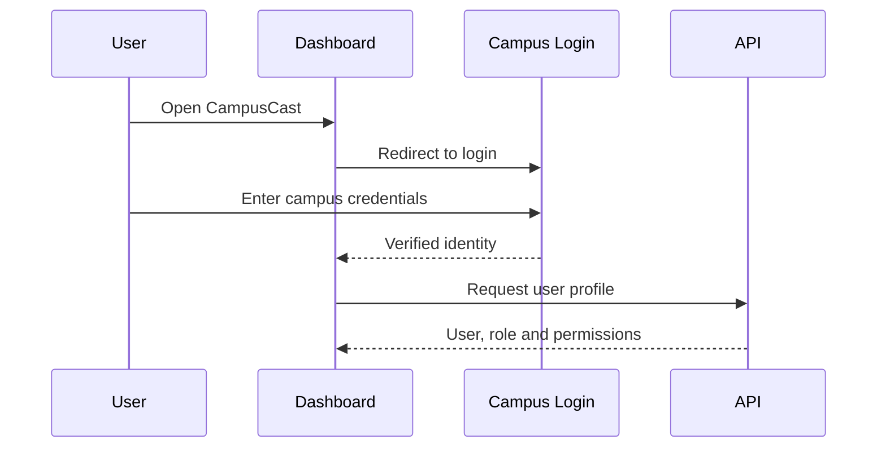
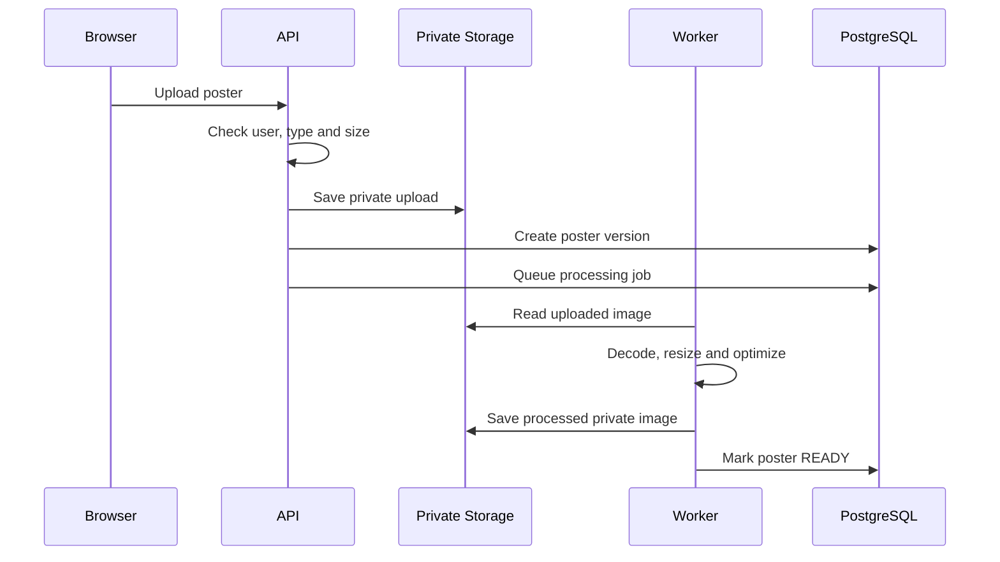
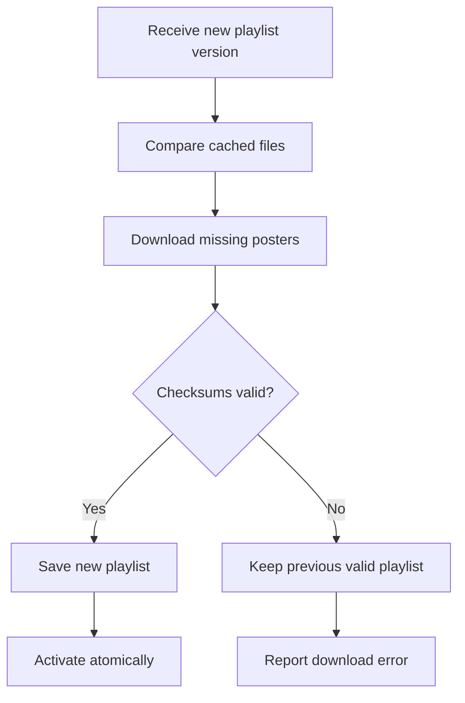

# 📺 CampusCast — Enterprise IoT Digital Signage Network

[](https://github.com/Gaurav-205/AI-IoT-Based-Smart-Screen)
[](https://nextjs.org/)
[](https://www.typescriptlang.org/)
[](https://www.prisma.io/)
[](LICENSE)

**CampusCast** connects four core processes:
```
Poster creation ──► Verified approval ──► Automatic scheduling ──► Screen delivery and monitoring
```

---

## 🏛️ Complete System Overview



---

## 📋 Detailed 27-Step System Workflow

### 1. User Login Flow
Users open `https://campuscast.college.edu`. Caddy receives the HTTPS request and serves the React dashboard. If the user is not logged in, CampusCast redirects them to the institution’s login system.



CampusCast receives the user identity and loads their authorization information from PostgreSQL:
```json
{
  "userId": "usr_101",
  "name": "Gaurav",
  "role": "DESIGN_LEAD",
  "clubId": "technology-club"
}
```
> **Security Note**: Roles are strictly scoped. Being *President of Technology Club* does not grant permissions over other clubs.

---

### 2. Design Lead Creates an Event
The Design Lead selects **“Create Event”** and inputs:
* Event name, Description, Club, Venue, Event date, Start and end time
* Contact information, Registration link, Target screens or locations, Poster image

Frontend validates basic fields; the API repeats all validation (`POST /api/v1/events`).

PostgreSQL atomically creates:
1. Event Record
2. Poster Submission
3. Draft Poster Version (`DRAFT`)
4. Audit Log Entry

---

### 3. Poster Upload & Processing Flow
The Design Lead uploads a PNG, JPEG, or WebP image.



The Sharp image worker:
- Decodes the file as a real image to reject corrupt content.
- Strips EXIF metadata.
- Corrects image orientation and resizes oversized images.
- Converts to WebP or optimized JPEG.
- Calculates a cryptographic SHA-256 checksum.
- Stores the processed file privately (unapproved media remains private).

---

### 4. Poster Submission
After previewing the processed poster, the Design Lead submits it via `POST /api/v1/posters/:posterId/submit`.
* **Status Change**: `DRAFT` ➔ `PENDING_PRESIDENT`
* **Validation**: Checks event date validity, club ownership, poster readiness, and target screens.
* **Immutability**: Once submitted, that poster version is locked. Any subsequent edit generates a new poster version.

---

### 5. Club President Approval
The Club President views submissions via `GET /api/v1/approvals/inbox` and verifies:
* Correct club branding, Poster details, Event title, Contact info, Target audience.

**Possible Actions**:
- **Approve**: `PENDING_PRESIDENT` ➔ `PENDING_HOD`
- **Request Changes**: `PENDING_PRESIDENT` ➔ `CHANGES_REQUESTED` (Design Lead resubmits new version)
- **Reject**: `PENDING_PRESIDENT` ➔ `REJECTED` (Comment required for rejections/changes)

---

### 6. Head of Department (HOD) Approval
After President approval, the HOD receives the submission.
* **Verification**: Event legitimacy, Department authorization, Venue & Date availability, Schedule conflicts.
* **Status Change**: `PENDING_HOD` ➔ `PENDING_ADMIN`

---

### 7. Campus Admin Approval
The Campus Admin performs final governance review:
* All prior approvals exist and are valid.
* Compliance with campus guidelines, venue availability, and display screen appropriateness.
* **Status Change**: `PENDING_ADMIN` ➔ `APPROVED`

---

### 8. Transactional Approval Protection
Every approval executes within a single PostgreSQL transaction:
```
Lock poster record ──► Check workflow stage ──► Check reviewer scope
       │
       ▼
Insert audit log ◄── Update status ◄── Insert approval record
       │
       ▼
Queue follow-up job ──► Commit transaction
```
If any step fails, the entire transaction is rolled back, preventing race conditions or partial approval states.

---

### 9. Automatic 21-Day Scheduling
Upon final approval, CampusCast computes the display availability window:
* **Display Start**: Event date − 21 calendar days (00:00:00)
* **Display End**: End of event day (23:59:59)

*Example*: For an event on 30 August 2026, the active display window is `2026-08-09T00:00:00+05:30` to `2026-08-30T23:59:59+05:30`. If approved on 20 August, it becomes active immediately as the start date has passed.

---

### 10. Publishing Approved Media
Once approved, the background worker promotes the poster asset from private to public storage:
```
/data/posters/private/... ──► Final Approval ──► /data/posters/public/{checksum}.webp
```
The SHA-256 checksum forms the public filename (e.g., `/media/af1d9038c2.webp`), served via Caddy.

---

### 11. Playlist Generation
Playlists are dynamically generated for each display node selecting items where:
`status = 'APPROVED' AND active_from <= now AND active_until >= now`.

```json
{
  "screenId": "dev_tech_f1_01",
  "version": 43,
  "generatedAt": "2026-08-09T00:00:00+05:30",
  "items": [
    {
      "posterId": "poster_101",
      "url": "/media/af1d9038c2.webp",
      "sha256": "af1d9038c2...",
      "durationSeconds": 15,
      "activeFrom": "2026-08-09T00:00:00+05:30",
      "activeUntil": "2026-08-30T23:59:59+05:30"
    }
  ]
}
```

---

### 12. Screen Enrollment
An administrator enrolls physical screens before operation, creating a `deviceId`, hardware location, and a hashed `deviceSecret` stored securely in PostgreSQL.

---

### 13. Screen Synchronization
Screens contact CampusCast every ~60 seconds (`POST /api/v1/screens/:deviceId/sync`) with random jitter (50–70s) to prevent thundering herd requests.

**Sync Request**:
```json
{
  "playlistVersion": 42,
  "kioskVersion": "1.2.0",
  "freeStorageMb": 2048,
  "playbackEvents": []
}
```

**Sync Response**:
```json
{
  "serverTime": "2026-08-09T10:00:00+05:30",
  "playlistVersion": 43,
  "playlistChanged": true,
  "commands": []
}
```

---

### 14. Playlist Download and Caching


The active working playlist is never purged until the new playlist is fully verified and activated.

---

### 15. Poster Playback Engine
Kiosks run fullscreen 15-second cycles:
`Poster 1 (15s) ➔ Poster 2 (15s) ➔ Poster 3 (15s) ➔ Repeat`.
Pre-playback checks verify file cache existence, SHA-256 integrity, current time bounds, and active status. Corrupt or missing files are safely skipped.

---

### 16. Playback Reporting
Kiosks generate local playback telemetry events:
```json
{
  "eventId": "play_unique_101",
  "posterId": "poster_101",
  "playlistVersion": 43,
  "startedAt": "2026-08-09T10:00:00+05:30",
  "completedAt": "2026-08-09T10:00:15+05:30",
  "status": "SUCCESS"
}
```
Unique `eventId` keys prevent duplicate logging if reports are retried during reconnection.

---

### 17. Screen Health Monitoring
Heartbeat timestamps automatically calculate display status:
- **Online**: Heartbeat received within last 15 seconds.
- **Warning**: Heartbeat delayed.
- **Offline**: 3 consecutive heartbeats missed (triggers an incident ticket).

---

### 18. Remote Command Engine
Admins dispatch commands (`REFRESH_PLAYLIST`, `RELOAD_APP`, `CLEAR_UNUSED_CACHE`, `UPDATE_CONFIGURATION`) delivered during kiosk sync. State transitions:
`QUEUED` ➔ `DELIVERED` ➔ `ACKNOWLEDGED` ➔ `COMPLETED` (or `FAILED`). Every command includes an expiration TTL.

---

### 19. Event Update Flow
Editing an approved event creates a **new poster version**. The existing approved version remains active on screens until the new version completes the entire approval chain.

---

### 20. Event Cancellation
An Admin cancels an event (`APPROVED` ➔ `CANCELLED`). CampusCast instantly deactivates the display schedule, increments screen playlist versions, removes the poster from manifests, and logs the cancellation in the audit trail.

---

### 21. Poster Expiration & Cleanup
When `current_time > active_until`, database playlist queries automatically stop returning the item. A background cleanup worker (`POST /api/v1/admin/cleanup`) prunes stale playlist records and purges unreferenced media files.

---

### 22. Offline Operation & Resilience
During network loss:
1. Sync retries with exponential backoff.
2. Display continues rotation using verified `IndexedDB` manifests and `Cache Storage` WebP assets.
3. Telemetry events queue locally in `IndexedDB`.
4. Upon reconnection, pending reports upload automatically.

---

### 23. Background Worker Queue
Slower operations (poster processing, playlist generation, screen health checks, media purges) are handled asynchronously via `pg-boss` queues stored in PostgreSQL with dead-letter retry safety.

---

### 24. Immutable Audit Trail
Sensitive mutations write append-only records to `AuditLog`:
```json
{
  "actorId": "usr_101",
  "action": "POSTER_APPROVED",
  "resourceId": "poster_101",
  "previousState": "PENDING_ADMIN",
  "newState": "APPROVED",
  "timestamp": "2026-08-08T12:00:00Z",
  "requestId": "req_501"
}
```
> **Privacy Note**: Credentials, passwords, and tokens are strictly prohibited from audit logs.

---

### 25. Automated Disaster Recovery & Backups
Nightly `pg_dump` database dumps and media snapshots are encrypted via Restic and stored on secondary offsite storage. Recovery restores are periodically tested in isolated environments.

---

### 26. CI/CD Deployment Pipeline
GitHub Actions pipeline executes:
`Install ➔ Lint ➔ Type-Check ➔ Unit Tests ➔ Build ➔ Browser Tests ➔ Docker Build ➔ Staging Deploy ➔ Production Deploy ➔ Health Verification`.

---

### 27. Complete Business Flow Summary

> **The Fundamental System Guarantee**:
> **No poster becomes public or reaches any screen display node until that exact poster version completes the entire verified approval chain.**

```
Campus user logs in
  ➔ Design Lead creates event
  ➔ Poster is uploaded and validated
  ➔ President approves
  ➔ HOD approves
  ➔ Campus Admin approves
  ➔ 21-day schedule is created
  ➔ Approved poster is published
  ➔ Screen receives and caches playlist
  ➔ Poster is displayed
  ➔ Playback and health are reported
  ➔ Poster automatically expires after the event
```

---

## 🛠️ Local Installation & Development Setup

```bash
# 1. Clone Repository
git clone https://github.com/Gaurav-205/AI-IoT-Based-Smart-Screen.git
cd AI-IoT-Based-Smart-Screen

# 2. Install Dependencies
npm install

# 3. Setup Database Schema & Seed Data
npx prisma db push
npx prisma db seed

# 4. Start Development Server
npm run dev

# 5. Run Verification Pipeline
npm test        # 8 Passing Unit Tests
npm run lint    # TypeScript Strict Check
npm run build   # Next.js Production Build
```

---

## 📄 License

Distributed under the MIT License. See `LICENSE` for details.
