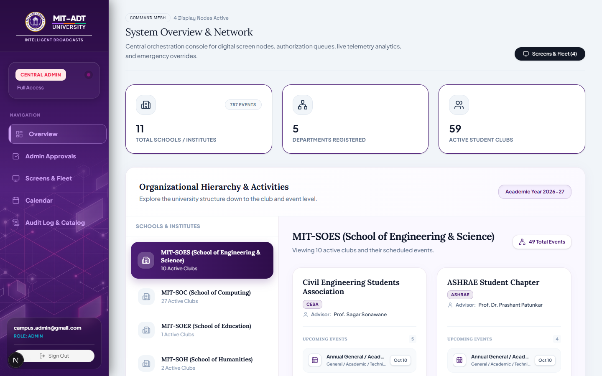
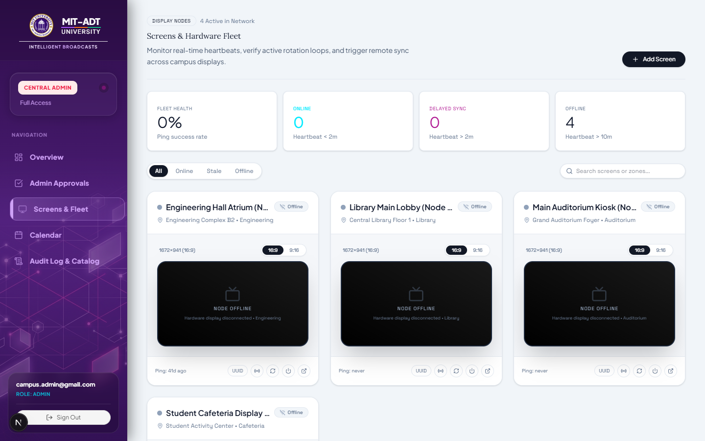
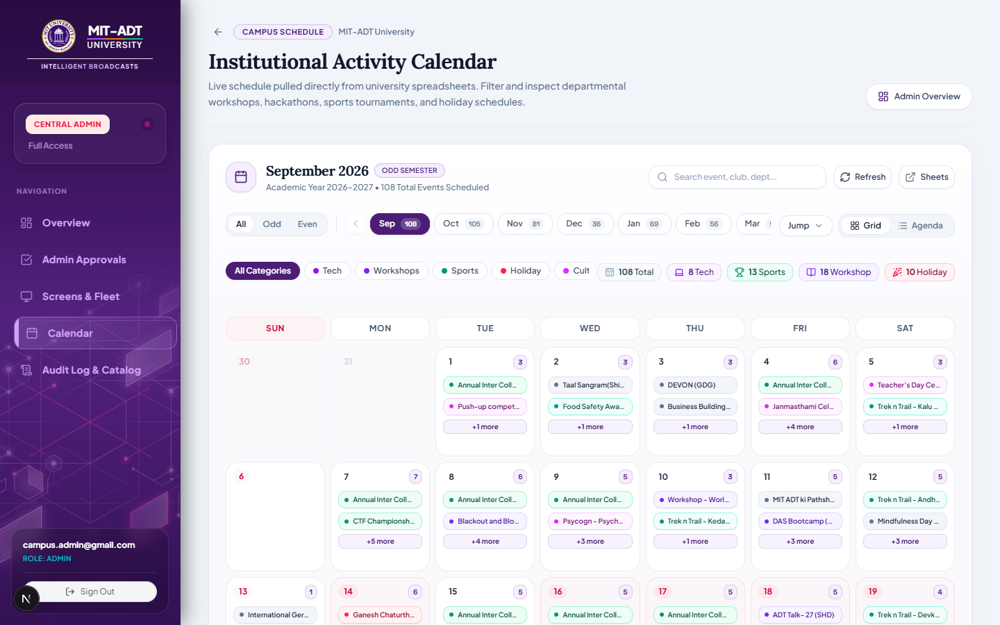
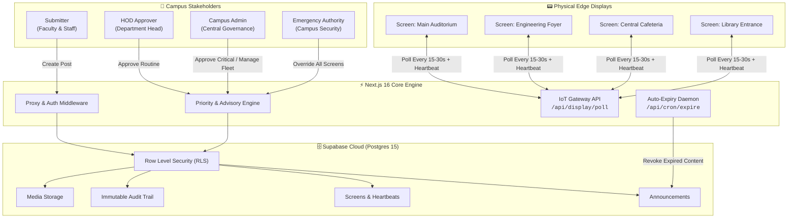

<div align="center">

# 📡 CampusCast — IoT Smart Screen & Digital Signage Network

**An enterprise-grade governance, priority routing, and delivery network for campus digital displays.**

[](https://campuscast-smart-screen.netlify.app)
[](https://nextjs.org/)
[](https://supabase.com/)
[](https://tailwindcss.com/)

<br />

### 🌐 [https://campuscast-smart-screen.netlify.app](https://campuscast-smart-screen.netlify.app)

</div>

---

## 🖥️ Live Application Preview

<div align="center">

### 1. Central Admin & Governance Overview
*Real-time overview of active broadcasts, approval queues, and system telemetry.*
<br />


<br /><br />

### 2. IoT Fleet Monitor & Display Telemetry
*Live health monitoring, heartbeat tracking, and zone allocation across physical smart screens.*
<br />


<br /><br />

### 3. Academic & Event Calendar
*Synchronized campus schedules and event timelines routed to dedicated departmental screens.*
<br />


</div>

---

## 🏛️ System Architecture



---

## 🛡️ Priority & Approval Routing

| Priority Level | Visual Tag | Approver | Target Scope | Expiry Behavior |
| :--- | :---: | :--- | :--- | :--- |
| **Routine** | 🟢 Routine | **HOD** of owning department | Departmental screens | 7 Days |
| **Time-Sensitive**| 🟡 Urgent | **HOD** of owning department | Specified zones / event dates | Scheduled event end |
| **Critical** | 🟠 Critical | **Campus Admin** (`/dashboard/admin`) | Campus-wide screens | 48 Hours |
| **Emergency** | 🔴 Emergency | **Zero-Approval** (Instant Override) | 100% of all online screens | 4 Hours / Manual Clear |

---

## 👥 Role-Based Access Control (RBAC)

| Role | Primary Dashboard | Permissions & Capabilities |
| :--- | :--- | :--- |
| **`submitter`** | `/dashboard/submitter` | Draft announcements, attach media creatives, select target physical zones, track live broadcast status. |
| **`hod`** | `/dashboard/hod` | Review departmental routine & time-sensitive items; approve or reject with audit comments. |
| **`admin`** | `/dashboard/admin` | Campus-wide governance, approve critical announcements, monitor IoT screen fleet, manage user roles, review audit logs. |
| **`emergency`** | `/dashboard/admin/emergency` | Dispatch high-priority emergency alerts that immediately take over all physical screens. |

---

## 📟 IoT Edge Display Polling Contract

Smart display kiosks securely poll the central server over authenticated HTTP:

```http
GET /api/display/poll?screen_id=SCREEN_UUID&token=DEVICE_SECRET
```

### JSON Response Specification

```json
{
  "status": "active",
  "screen_name": "Main Auditorium Screen",
  "refresh_interval_sec": 30,
  "active_broadcast": {
    "id": "e42718e2-...",
    "priority": "critical",
    "headline": "Annual Convocation 2026",
    "content": "All students are requested to assemble by 09:30 AM in formal attire.",
    "media_url": "https://...supabase.co/storage/v1/object/public/campuscast-media/...",
    "expires_at": "2026-11-05T18:00:00Z"
  },
  "emergency_active": false
}
```

*Displays feature **Offline Resilience**: in case of network interruptions, the edge display continues rendering the last securely cached broadcast.*

---

<div align="center">

**Live Production Link:** [https://campuscast-smart-screen.netlify.app](https://campuscast-smart-screen.netlify.app)

</div>
